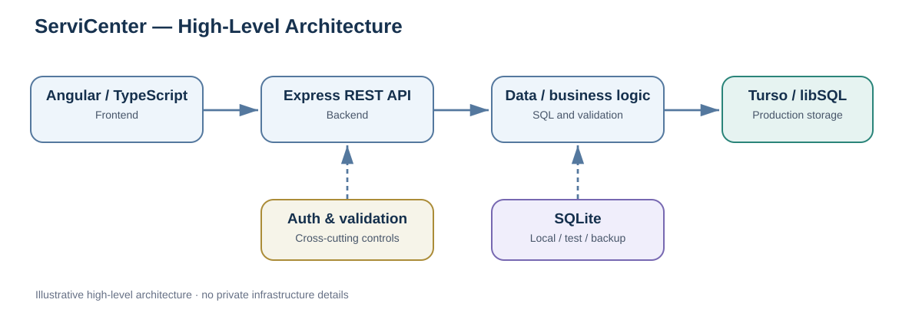
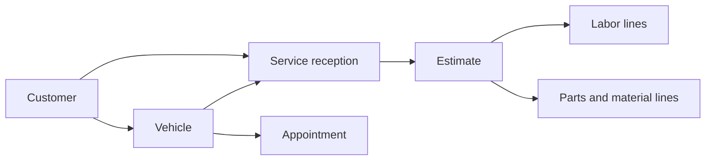

# ServiCenter — Architecture & Data Engineering Case Study

**A full-stack automotive service management application** | Architecture, relational data, historical data ingestion & operational workflows

> **Documentation-only portfolio repository.** The application source code and production data are private. This repository describes the architecture and selected data workflows; it is not a runnable copy of the application.

## Overview

ServiCenter was created around the day-to-day workflows of an automotive service business. It brings together customer and vehicle records, appointments, service intake, estimates, revenue reporting, historical data import, and backup/restore operations.

My interest in this project is especially focused on its **relational data model**, **Excel data-ingestion workflow**, **data integrity rules**, and **SQL-based processing**.

## Technology stack

| Layer | Technologies |
| --- | --- |
| Frontend | Angular, TypeScript, RxJS |
| Backend | Node.js, Express, REST API |
| Production persistence | Turso / libSQL |
| Development, tests & backups | SQLite |
| Historical file ingestion | ExcelJS |
| Deployment | Render, Git / GitHub |

The components above describe the application as documented at the time of preparing this case study.

## System architecture

The Angular frontend communicates with an Express REST API. Backend modules apply authentication, validation, and business rules before reading or writing relational data. Production persistence uses Turso/libSQL; SQLite is used for local development, testing, import/export, and backups.

See [Architecture notes](docs/architecture.md) for a more detailed breakdown.

## Data Engineering highlights

- **Relational modeling:** connected customer, vehicle, appointment, reception, and estimate data, with foreign keys, indexes, and historical snapshots.
- **Historical Excel ingestion:** file parsing, preview, validation, identity matching, duplicate/conflict detection, and atomic database writes.
- **Data integrity:** conservative record matching, conflict checks, and preservation of source identifiers and historical values.
- **SQL processing:** database-side searches, filtered estimates, revenue aggregation, and `COUNT`-based backup statistics.
- **Recovery:** SQLite export and restore workflows, alongside controlled legacy-import operations.

### Historical data import

The import workflow previews incoming records, applies validation and duplicate checks, and flags conflicts for review. Accepted data is written transactionally to reduce the risk of partial updates.

Read the [Excel import case study](docs/excel-import.md) for the detailed rules and trade-offs.

## Data model (conceptual)

The domain includes customer and vehicle records, appointments, service reception records, estimates, and separate estimate lines for labor and parts/materials.

*This diagram is an intentionally simplified domain view, not an exhaustive physical database schema.*

## Reliability, security & operational considerations

The application includes authentication, input validation, protected operational workflows, and transactional updates for related records. Detailed security configuration is intentionally not published.

Performance work includes pushing searches and revenue aggregation to the database instead of loading unnecessary records into application memory.

Automated tests and frontend build checks support iterative changes. Private test details and operational results are intentionally omitted from this public case study.

## Development approach

I defined the project's functional goals and guided its iterative development with substantial assistance from AI coding tools. This case study documents the resulting system and the data-engineering concepts I am consolidating through hands-on study.

## Why the source code is private

ServiCenter is an internal-use application. The full source, operational configuration, customer/vehicle records, production database, and private workflows are intentionally not distributed in this public portfolio.

This repository shares **sanitized, high-level documentation only**. Diagrams are illustrative and contain no production data. There is no public demo or access to the live administrative application here.

## Related links

- [GitHub profile](https://github.com/RusSergiuhub)
- [LinkedIn](https://www.linkedin.com/in/rus-sergiu/)

---
**Focus areas:** relational databases · SQL · data ingestion · data validation · ETL concepts · API-based systems
