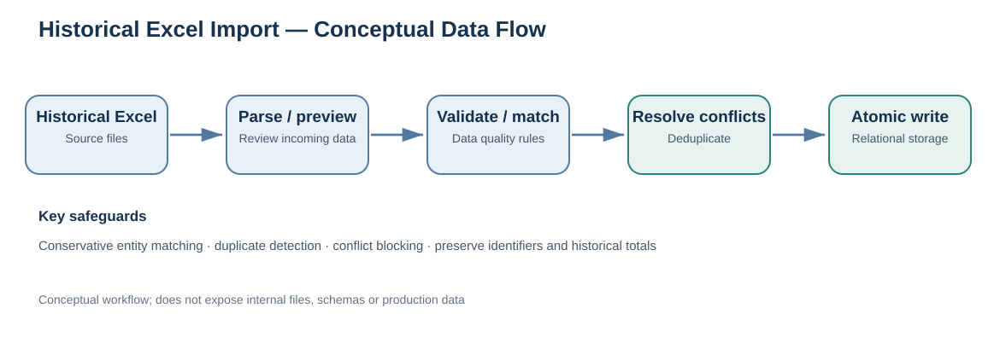

# Historical Excel Import — Data Workflow Case Study

This document describes the documented historical data-ingestion workflow for an internal automotive service application.

## Problem

Historical Excel exports contain records that may already exist in the relational database. Loading them without checks could create duplicate customers, incorrectly merge vehicles, or lose identifiers and historical values.

## Documented workflow

1. **Select source files:** choose historical Excel files for a controlled batch import.
2. **Parse and preview:** identify the records to create, reuse, or ignore before writing them.
3. **Calculate a fingerprint:** derive an import fingerprint as part of the preview workflow.
4. **Validate and match:** compare incoming customers and vehicles against existing data using conservative identification rules.
5. **Detect duplicates and conflicts:** block unresolved conflicts instead of silently merging contradictory records.
6. **Confirm and persist:** commit validated data as an atomic operation.

## Data-quality principles

- Validate identifying attributes before linking incoming records to existing entities.
- Apply conservative matching rules; uncertain records are reviewed rather than silently merged.
- Detect duplicates and unresolved conflicts before loading accepted records.
- Preserve identifier formatting and source historical values.

## Why these rules matter

These safeguards address common data-engineering problems: **entity resolution**, **deduplication**, **validation**, **preservation of source semantics**, and **transactional loading**.

The import is an **application-level batch ingestion workflow**. This repository does not claim that Apache Airflow, Kafka, or a separate enterprise ETL platform runs this process.

## Privacy and scope

No customer records, real Excel files, production schemas, import credentials, or executable internal implementation are published here. The diagram is an illustrative summary of the recorded workflow.
